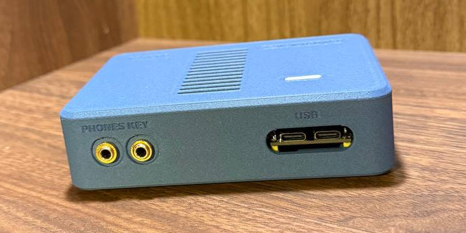
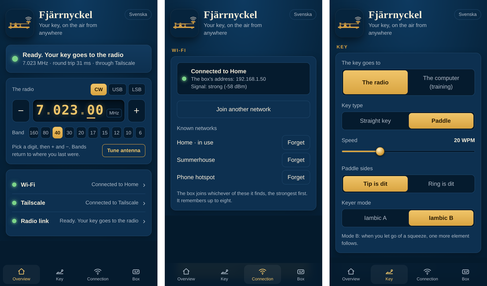
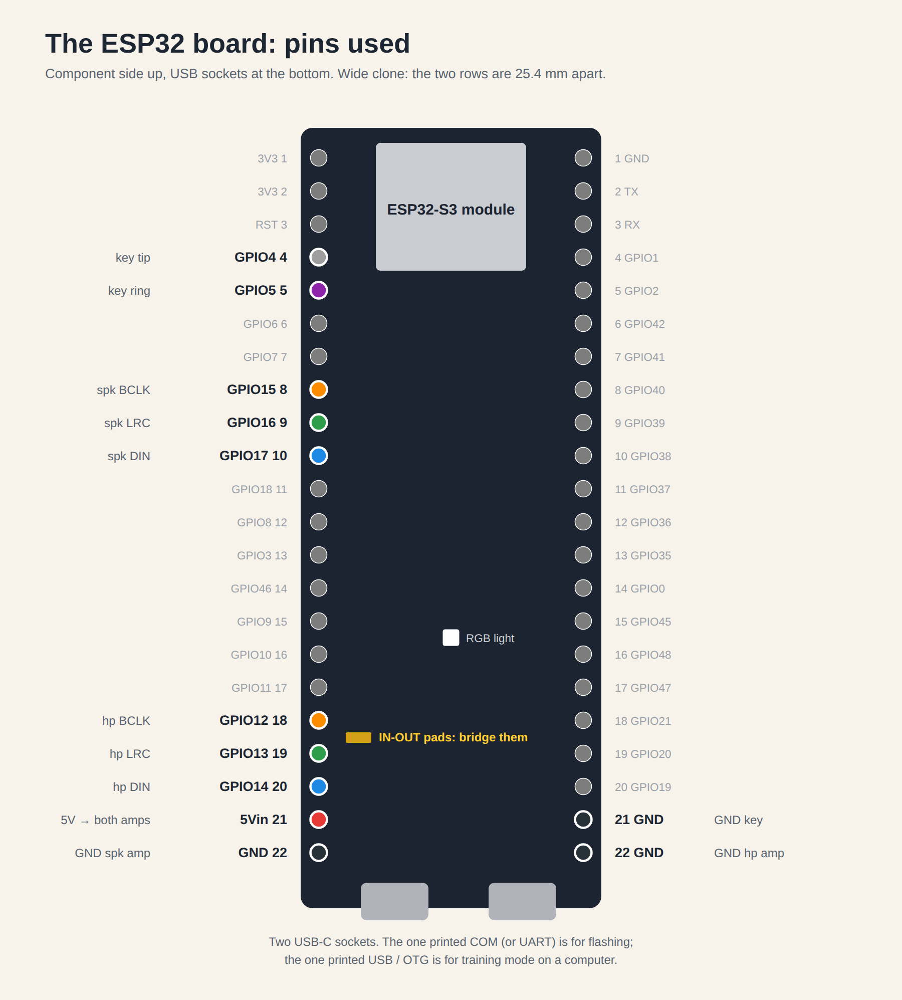

<p align="center"></p>

# Fjärrnyckel

*Swedish for "remote key".* Send Morse code on a radio that is somewhere else,
with your own straight key or paddle, and have it go on the air exactly as you
keyed it.

Fjärrnyckel is for radio amateurs who run a remote station, for example an
Icom radio controlled with [wfview](https://wfview.org/). Voice and digital
modes work well over such a link. Morse does not, because the timing of your
hand is lost on the way. Fjärrnyckel carries the timing.

<p align="center"></p>

## How it works

- **The box** sits on your desk. It is an ESP32-S3 with a key jack and a small
  speaker. It reads your key, plays the sidetone at once, and sends every key
  movement with the exact time it happened.
- **The receiver** runs on the computer by the radio. It replays each movement
  a fixed, short moment later and keys the radio over its USB cable. Network
  jitter is absorbed; dots, dashes and your own rhythm are reproduced as you
  made them.
- **The link** between them is signed with a shared key, so only your box can
  key your radio, and the receiver lets go of the key if the link is lost.

### The box's page

Everything is set up from the box's own web page, on a phone or a computer: Wi-Fi, Tailscale (built into
the box, no computer needed on your side), the receiver, the keyer and the sidetone. It also installs
updates and makes backups. English and Swedish.

<p align="center"></p>

## Status

Work in progress. Honest state of each part:

| Part | State |
|---|---|
| Receiver (`receiver/`) | Working. **Only tested with the IC-7300** (Raspberry Pi 4, wfview). Knows the USB keying menu of the IC-7300MK2, IC-705, IC-9700, IC-7610 and IC-905 from Icom's CI-V guides, not yet tried on them; see [Radios](docs/receiver-raspberry-pi.md#radios). |
| Keying protocol (CWL2) | Working. Covered by tests, including loss and jitter. |
| Box firmware (`firmware/`) | Working on hardware: keyer (straight key and iambic A/B), sidetone in speaker and headphones, keying the radio over Wi-Fi or Tailscale, setup page. Training over USB works, both as MIDI (with Vail) and as a keyboard (tested 2026-11-24). The USB sound card for radio audio works with a Mac (tested 2026-11-24, from 0.11.3). |
| Tailscale in the box | In the firmware from 0.3.0 (MicroLink), with sign-in from the setup page. |
| Updates over Wi-Fi | From 0.4.0: the box finds new releases and installs them from its page. |
| Password on the setup page | From 0.5.0: optional, off until you set one. |
| Status light and tones, signed firmware, reset with the key | From 0.6.0. |
| Enclosure (`enclosure/`) | Printed and assembled (2026-11-24): everything fitted as drawn. |
| VFO knob (`vfo/`) | Draft of a companion tuning knob. |

## Build your own

The box is built from ready-made boards, a printed enclosure and an evening of soldering. No programming:
the firmware is installed from the browser. The drawings below are exact; follow them.

### 1. What you need

| Part | Get this | Example |
|---|---|---|
| ESP32-S3 board | **ESP32-S3 N16R8 "DevKitC-1" wide clone** with two USB-C sockets and 2 × 22 pins, the rows **25.4 mm apart** (10 holes on a breadboard), with **IN-OUT pads**. Layout of the VCC-GND *YD-ESP32-S3*. The narrower original Espressif board does not fit the box. | [Amazon.se search](https://www.amazon.se/s?k=ESP32-S3+N16R8+DevKitC-1) |
| 2 × amplifier | MAX98357A I2S breakout, 17.8 × 19.3 mm, 7-pin header (LRC, BCLK, DIN, GAIN, SD, GND, Vin) | [3-pack, Amazon.se](https://www.amazon.se/dp/B0F21T7Q3P) |
| Speaker | CQRobot 3 W 4 Ω enclosed speaker, 70 × 31 × 16 mm, four corner holes | [Pair, Amazon.de](https://www.amazon.de/dp/B0822XCPT8) |
| 2 × 3.5 mm socket | PJ-392 stereo panel socket with nut (6 mm hole) | [Amazon.se search](https://www.amazon.se/s?k=PJ-392+3.5mm) |
| 4 × threaded insert | ruthex RX-M3x5.7 heat-set insert | [100-pack, Amazon.se](https://www.amazon.se/dp/B08BCRZZS3) |
| 4 × screw | M3 × 8, head at most 6 mm across | any hardware store |
| Resistor | 220 Ω, ¼ W (for the headphones) | |
| Wires | 10 female–female Dupont jumper wires, about 10 cm (5 per amplifier), plus thin hook-up wire for the sockets | |
| Foam | 1 mm foam tape (four small pads) and a 0.5 mm foam pad | |
| Feet | 4 stick-on feet, 10 mm | |
| Filament | PLA or PETG for the box; clear or white for the light lens | |

You also need your key or paddle with a 3.5 mm **stereo** (three-contact) plug, a USB-C **data** cable
and a USB power supply. For the PHONES socket use ordinary passive stereo headphones only: it is a
floating amplifier output, so never connect it to a computer's input or to powered speakers.

**Tools:** soldering iron with a heat-set insert tip, multimeter, flush cutters, heat-shrink tubing,
hot glue, a computer with Chrome or Edge.


### 2. Print the box

Files are in [`enclosure/stl`](enclosure/stl):

| File | How to print |
|---|---|
| `fjarrnyckel-base.stl` | as it lies, opening up, no supports |
| `fjarrnyckel-print_lid.stl` | already upside down (flat top on the bed), no supports |
| `fjarrnyckel-lens.stl` | flat, clear or white filament |
| `fjarrnyckel-coupon.stl` | **print this first** (about 20 minutes): a board saddle, an amplifier stand, an insert post and a speaker pin. Try your own board, an amplifier with its plugs, an insert and the speaker in it before you print the box. |

Settings: 0.2 mm layers, **4 walls** (the insert posts then come out nearly solid), 5 top and bottom
layers, 20–25 % gyroid infill; the lens at 100 %. Remove any strings from the grille slots and the USB
opening.

### 3. Set the inserts

Put the lid upside down. Heat each of the four brass inserts with the iron and press it straight down
into a post under the lid until it is flush. Let it cool before you move on.


### 4. Prepare and test the ESP32 board



**Bridge the IN-OUT pads.** On this board the 5Vin pin (J1 pin 21) only gives out the USB 5 V when the
two small pads marked IN-OUT are joined. Melt a small blob of solder across them.


**Check it:** plug USB in and measure between 5Vin (J1-21) and GND (J1-22). You should see about 5 V. With
the pads open you see about 0 V.

**Install the firmware now**, before anything is soldered, so you know the board works:

1. Download `fjarrnyckel-usb.bin` from the
   [latest release](https://github.com/sa3lej/fjarrnyckel/releases/latest).
2. Connect the board with a USB **data** cable to the USB-C socket marked **COM** (or UART). If no serial
   port appears on the computer, try another cable, or install the CH343 USB driver.
3. Open the [Espressif web flasher](https://espressif.github.io/esptool-js/) in Chrome or Edge and press
   **Connect**; choose the board's serial port.
4. Under *Flash address* type **0x0**, choose `fjarrnyckel-usb.bin`, and press **Program**.
   If it hangs on *Connecting*: hold the board's **BOOT** button, press and release **RST**, release
   BOOT, and press Connect again.
5. When it is done, unplug and plug in again. The light on the board shows that the box is starting, and a
   Wi-Fi network called **Fjarrnyckel-XXXX** appears.

You only do this once. Later updates come from the box's own page: **Box → Software → Look for
updates**. (For *Install from a file…* use `fjarrnyckel-update.bin`; `fjarrnyckel-usb.bin` is only for this
first install.)

### 5. Wire it

Everything uses the board's left row **J1** (counted from the top with the USB sockets at the bottom and
the components facing you), plus two GND pins at the bottom of the right row **J2**.


**The board.** The pins point down into the box, so solder the wires to the tops of the pins, on the
component side. Keep them short and leave them on the J1 side: in the box that row faces the speaker.


**Always unplug USB before you solder.**

**The amplifiers.** Before soldering, dry-fit: stand the amplifier in its two grooved posts. The 7-pin row
runs along the bottom edge, and the pins must stick out on the side that faces the speaker, because that
is where the plugs go. Then solder the straight 7-pin header to each amplifier. Leave **GAIN** and **SD**
unconnected. Push Dupont plugs onto the five pins you use (LRC, BCLK, DIN, GND, Vin), cut the other ends and solder them to the board as
in the chart. Then solder the outputs on the opposite edge:

- speaker amplifier: **+** to the speaker's red wire, **−** to its black wire;
- headphone amplifier: **+** through the 220 Ω resistor to the PHONES socket's **tip**, with tip and
  **ring** joined by a short wire so you hear it in both ears; **−** to the PHONES socket's **sleeve**.

Neither amplifier's − is ground. Never connect the PHONES sleeve to GND or to the KEY socket, and never
join the two amplifiers' − wires.

**The sockets.** Fit both sockets in the back wall with their nuts first (KEY on the right, PHONES on the
left, seen from behind). A PJ-392 has two lugs, for the **tip** and the **ring**; the **sleeve** is its
threaded metal body, so solder the sleeve wire to the body (or to a solder tag under the nut). Find out
which lug is which with the multimeter and a plug: the tip lug connects to the point of the plug, the ring
lug to the band behind it, the body to the long part nearest the cable. Then solder:

- KEY: tip to J1-4 (GPIO4), ring to J1-5 (GPIO5), sleeve to J2-21 (GND);
- PHONES: as above, from the headphone amplifier.

Cover every joint with heat-shrink.


### 6. Put it together


1. Slide each amplifier down into its two grooved posts with the plugs facing the speaker: the speaker
   amplifier at the front, the headphone amplifier at the back, next to the sockets.
2. Set the ESP32 board on its two saddles with the USB sockets in the opening in the back wall. The black
   plastic strips of the pins rest on the saddles.
3. Lay the wires flat on the floor between the board and the amplifiers.
4. Put the speaker on its two ribs, cone up, over the wires. Lead its cable round the end of a rib.
5. A dab of hot glue over each amplifier's row of plugs keeps them from working loose (a loose plug
   crackles).


**Check before power.** With USB unplugged, use the multimeter's beep test:

- 5Vin (J1-21) to GND (J1-22): **no** beep (no short);
- each wire against its neighbours on the board: no beep;
- PHONES sleeve to GND and to the KEY sleeve: no beep;
- every wire in the chart from end to end: beep.

**Then power it.** Plug USB in with the key released. You hear two short tones (low, then high) and the
light comes on. Press a straight key: you hear the sidetone in the speaker, and in headphones too (each has
its own volume on the page). A new box starts as *Straight key*; for a paddle, set **Key → Key type →
Paddle**. The tip is dit and the ring is dah; *Paddle sides* swaps them. Unplug USB again before you
close the box.

### 7. Close it

1. Stick a small piece of 1 mm foam tape on each of the four pads around the speaker frame inside the
   lid, and the 0.5 mm foam pad on the end of the short post that rests on the board's metal can.
2. Drop the lens into the light window from above; a tiny drop of glue at its edge keeps it in.
3. Lower the lid straight down: the four small pins find the speaker's corner holes.
4. Turn the box over and fit the four M3 × 8 screws. Stop as soon as they are snug.
5. Stick the four feet into the round seats underneath.


### 8. Start it

1. On your phone or computer, join the Wi-Fi network **Fjarrnyckel-XXXX**. The box's page opens by itself;
   if it does not, browse to **http://192.168.4.1**.
2. Under **Connection → Wi-Fi**, choose your home network, type its password and press **Connect**. Then
   put your phone or computer back on your home network and open **http://fjarrnyckel.local** (or the
   address the page showed). The setup network switches itself off a minute after the box has joined.
3. Set up the computer by the radio: [Installing the receiver on a Raspberry Pi](docs/receiver-raspberry-pi.md).
   Then, under **Connection → Radio link**, enter the **Receiver address** and the **Shared key**, leave
   **Port** at 7373 and press **Save**. For the first test put the radio in CW with break-in off, and listen
   to the radio's own sidetone before you transmit.
4. To key the radio from anywhere: put the computer by the radio and the box on the same Tailscale
   network. On the box, **Connection → Tailscale → Connect to Tailscale**, then **Sign in to Tailscale**.
   Use the receiver's Tailscale name as the receiver address and leave **Relay** on *Automatic*.
5. Under **Box → Backup**, type a passphrase and press **Download backup**. Keep the file and the
   passphrase: you need both to restore it.

For practice sites on a computer, see [Training with practice sites](#training-with-practice-sites).

**What the light means**

| Light | Meaning |
|---|---|
| blue, blinking | the setup network is up: join it and set up Wi-Fi |
| red | no Wi-Fi |
| amber | Wi-Fi is there, the radio is not ready yet |
| green | ready: the key goes to the radio (bright while keyed) |
| turquoise | training mode: the key goes to the computer on USB |
| violet, blinking | an update is being installed |
| white | service mode |

You hear "R" in Morse when the box has been ready to key the radio for a second, and two low tones when it
has not been for three seconds. The tones wait until the key is up, and can be switched off under
**Box → Signals**.

## Training with practice sites

Set **The key goes to** to **The computer** on the box's page and run a cable from the board's port marked
USB to the computer. The box then shows up as a keyboard and a MIDI device, the way the VBand and Vail
adapters do, and nothing is sent to the radio:

- keyboard: dit is Left Ctrl, dah is Right Ctrl (VBand, Morse Code World, Morseorama, Lids Anonymous, ...);
- MIDI: notes 1 and 2 for the paddles, note 0 for finished keying; a site that speaks Vail's MIDI protocol
  switches the box over by itself. The box stays in MIDI until the computer lets go of it (unplugged or asleep)
  or you press **Back to keyboard** on the box's page: closing a site's tab sends nothing the box can hear.

With **Finished keying** the box's own keyer and sidetone are used and the site sees a straight key. With
**The two paddles** the site does the keying.

## Radio sound in the speaker or headphones

On its USB port the box is also a sound card, called **Fjarrnyckel**. Choose it as the audio output in wfview
(or for the whole computer) and the radio is heard in the box together with the sidetone. Like the sidetone, it
has a volume for the speaker and one for the headphones (Key → Radio sound from the computer); the speaker
starts at 0, so the radio is in the headphones only until you turn it up. The sidetone never leaves the box, so it stays
instant; the keying path to the radio is not touched.

The sound card runs at 48 kHz, 16-bit mono. The box follows the computer's clock: it plays the incoming sound a
few hundredths of a percent faster or slower to keep about 8 ms buffered, so the two clocks never drift apart. The computer's own volume and mute work as usual.

## Several Wi-Fi networks

The box remembers up to eight networks (Connection → Wi-Fi → **Known networks**): at home, at the summerhouse,
your phone's hotspot. It joins whichever it finds, the strongest first, and a network is only remembered once
the box has actually connected to it. **Join another network** adds one, **Forget** takes one away. The card
also shows how strong the signal is.

## The radio from the box

Keying is only on while the radio is in CW. So that you do not need wfview in front of you to get on the air,
the box's overview has a card for the radio. The frequency reads as on a radio's display: pick a digit and step
it with **+** and **−** (hold them to keep going), the mouse wheel or the arrow keys, or press **MHz** and type
one. Beside it are **CW**, **USB** and **LSB**, a button for each band from 160 to 6 m, and **Tune antenna**,
which starts the radio's antenna tuner (the radio transmits while it tunes). A band button goes to where you
last were on that band (the page remembers, per browser), or to the band's CW or phone part the first time.

These travel to the receiver as commands in packets of their own. The key's packets, and so the timing of your
keying, are exactly what they are without them, and the receiver carries a command out away from its keying
loop. It needs receiver version 3 or later; see the receiver's guide for how to turn it off there. Mode and
frequency are tried on an IC-7300 through wfview; the tuner button is not tried yet.

## The buffer, and the receiver's version

The receiver holds every key movement for a short, fixed time before it keys the radio; that is what evens
out the network. The time is set on the box's page (Connection → Radio link → **Buffer**, 10 to 200 ms, 25
to begin with). Lower is quicker; raise it if movements arrive late. The page tells how your last stretch of
keying went (a stretch ends after a minute without a key movement): how many key movements, and how many of
them were late or lost. When some were late it offers the buffer that would have covered them, with one button
to set it. It also shows the buffer the receiver is using right now, which is longer for a while after late
arrivals.

The same card shows the receiver's version, and says so when the receiver is older than the box's firmware
expects. Update it on the computer by the radio: `git pull` in its `fjarrnyckel` folder, then
`systemctl --user restart fjarrnyckel-receiver`.

## Tailscale relay region

The box's Tailscale client keeps one relay connection, to its own home region.
It has to be the home region of the computer by the radio; with different regions the box cannot reach the
receiver until the receiver happens to contact the box. Left on *Automatic*, the box reads the receiver's
region from the tailnet and moves there, restarting its Tailscale connection once. The region can also be
chosen by hand under Connection → Tailscale → Relay. `tailscale netcheck` on the receiver's computer shows
its region. Choosing the region needed a change to MicroLink, so the firmware carries its own copy in
`firmware/components/microlink` (see `FJARRNYCKEL.md` there).

## Updates

A new version is on trial for its first minute: if it crashes, hangs or loses power before that, the
box goes back to the version that worked. The box looks for a new version on its own (after it gets Wi-Fi, then twice a day) and shows it under
Software on its page. Nothing installs until you press the button; settings are kept. A firmware file can
also be installed from the same place.

Released firmware is signed, and the box only installs signed firmware. The private key is a secret of
this repository (`FN_SIGNING_KEY`); the public half is in `firmware/src/signing_key.h`. If you build your
own firmware, put your own public key there, or use service mode.

**Service mode and reset, with only the key.** Hold the key down while plugging the box in:

- let go after the first beep (5 seconds): the page's password is removed, and until the next restart the
  box also accepts firmware that is not signed;
- let go after the three beeps (15 seconds): all settings are erased and the box is as new;
- a key that never comes up (stuck, or switched closed) changes nothing.

## Backups

Box → Backup downloads one file (`.fnb`) with everything the box knows: Wi-Fi, the receiver and its key,
the Tailscale identity, the page password and every setting. Restoring it, also from the first-time setup
page after a reset, brings the box back as it was without adding it to Tailscale again. (If the box's
Tailscale key has expired in the meantime, it asks for a sign-in as usual.) Use one backup in one box at a
time: two boxes with the same Tailscale identity push each other off the tailnet.

The file is sealed with a passphrase you choose (PBKDF2-HMAC-SHA256, 100 000 rounds, then AES-256-GCM; see
`firmware/src/backup.h`), so it can be kept anywhere, but a weak passphrase is the weak point. Without a page
password anyone on the box's network can make a backup with their own passphrase, so set one if others
share that network. `tools/backup.py show <file>` opens a backup on a computer and lists what is in it.

A release is made by setting the version in `firmware/CMakeLists.txt` and pushing a tag `v<version>`.
GitHub Actions builds the firmware and publishes `fjarrnyckel-update.bin` (for the box's page),
`fjarrnyckel-usb.bin` (a full image for a new board, written at address 0) and `version.txt`.

## Tests

```
python3 -m unittest discover -s tests
```

These include the firmware's own link client (`firmware/src/cwl2.c`) built for the computer and run against the
real receiver, where there is a C compiler and OpenSSL's headers.

Keyer logic and backup files are also tested in C on the computer:

```
gcc -Wall -Ifirmware/src -o /tmp/iambic_test tests/host/iambic_test.c firmware/src/iambic.c && /tmp/iambic_test
TFPSA=<built TF-PSA-Crypto checkout> tests/host/run_backup_test.sh
```

If Fjärrnyckel is useful to you, [buy me a coffee](https://buymeacoffee.com/lejo).

## Licence

MIT. See [LICENSE](LICENSE). The designs in `enclosure/` and `vfo/` are under the same licence.

## Thanks

The rules of the keying link are modelled on OK1HRA's Paddle2IP. The packet
format and the code are our own.

73 de SA3LEJ
