# Build your own Fjärrnyckel

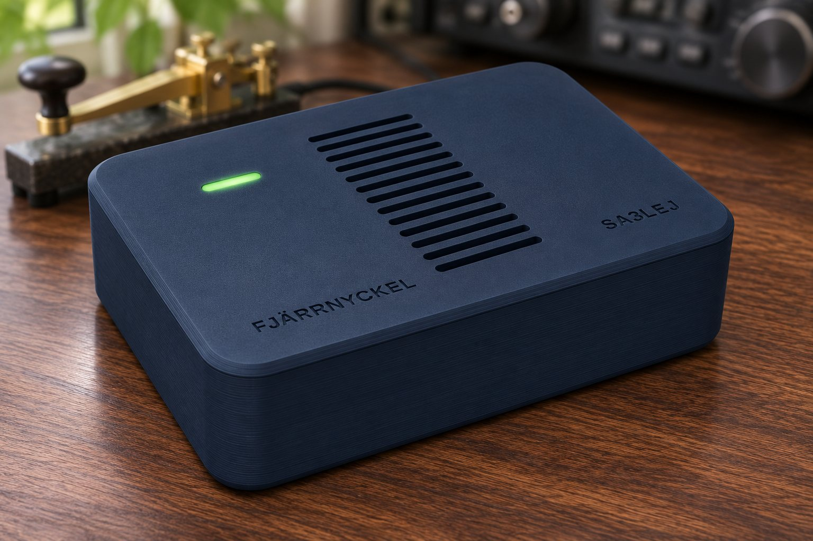

Fjärrnyckel is a small box for your Morse key or paddle. It keys your radio over the internet through
[wfview](https://wfview.org), with a sidetone in its own speaker or in your headphones, and it can also
key practice sites on a computer over USB. This guide takes you from a pile of parts to a working box in
an evening. No programming needed: the firmware is installed from the browser.

> Photos marked *illustration* are generated pictures that show what a step looks like. The drawings
> (board pins, wiring chart, layout) are exact: when a photo and a drawing disagree, follow the drawing.

## 1. What you need

| Part | Get this | Example |
|---|---|---|
| ESP32-S3 board | **ESP32-S3 N16R8 "DevKitC-1" wide clone** with two USB-C sockets and 2 × 22 pins, the rows **25.4 mm apart** (10 holes on a breadboard), with **IN-OUT pads**. Layout of the VCC-GND *YD-ESP32-S3*. The narrower original Espressif board does not fit the box. | [Amazon.se search](https://www.amazon.se/s?k=ESP32-S3+N16R8+DevKitC-1) |
| 2 × amplifier | MAX98357A I2S breakout, 17.8 × 19.3 mm, 7-pin header (LRC, BCLK, DIN, GAIN, SD, GND, Vin) | [3-pack, Amazon.se](https://www.amazon.se/dp/B0F21T7Q3P) |
| Speaker | CQRobot 3 W 4 Ω enclosed speaker, 70 × 31 × 16 mm, four corner holes | [Pair, Amazon.de](https://www.amazon.de/dp/B0822XCPT8) |
| 2 × 3.5 mm socket | PJ-392 stereo panel socket with nut (6 mm hole) | [Amazon.se search](https://www.amazon.se/s?k=PJ-392+3.5mm) |
| 4 × threaded insert | ruthex RX-M3x5.7 heat-set insert | [100-pack, Amazon.se](https://www.amazon.se/dp/B08BCRZZS3) |
| 4 × screw | M3 × 8, head at most 6 mm across | any hardware store |
| Resistor | 220 Ω, ¼ W (for the headphones) | |
| Wires | 10 female–female Dupont jumper wires, about 10 cm (5 per amplifier), plus thin hook-up wire for the sockets | |
| Foam | 1 mm foam tape (four small pads) and a 0.5 mm foam pad | |
| Feet | 4 stick-on feet, 10 mm | |
| Filament | PLA or PETG for the box; clear or white for the light lens | |

You also need your key or paddle with a 3.5 mm **stereo** (three-contact) plug, a USB-C **data** cable
and a USB power supply. For the PHONES socket use ordinary passive stereo headphones only: it is a
floating amplifier output, so never connect it to a computer's input or to powered speakers.

**Tools:** soldering iron with a heat-set insert tip, multimeter, flush cutters, heat-shrink tubing,
hot glue, a computer with Chrome or Edge.

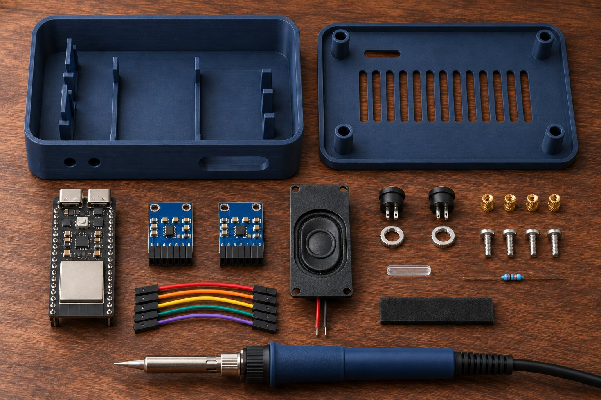

## 2. Print the box

Files are in [`enclosure/stl`](../enclosure/stl):

| File | How to print |
|---|---|
| `fjarrnyckel-base.stl` | as it lies, opening up, no supports |
| `fjarrnyckel-print_lid.stl` | already upside down (flat top on the bed), no supports |
| `fjarrnyckel-lens.stl` | flat, clear or white filament |
| `fjarrnyckel-coupon.stl` | **print this first** (about 20 minutes): a board saddle, an amplifier stand, an insert post and a speaker pin. Try your own board, an amplifier with its plugs, an insert and the speaker in it before you print the box. |

0.2 mm layers and 3 walls are fine. Remove any strings from the grille slots and the USB opening.

## 3. Set the inserts

Put the lid upside down. Heat each of the four brass inserts with the iron and press it straight down
into a post under the lid until it is flush. Let it cool before you move on.

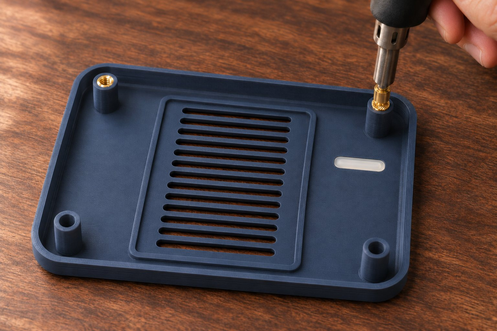

## 4. Prepare and test the ESP32 board

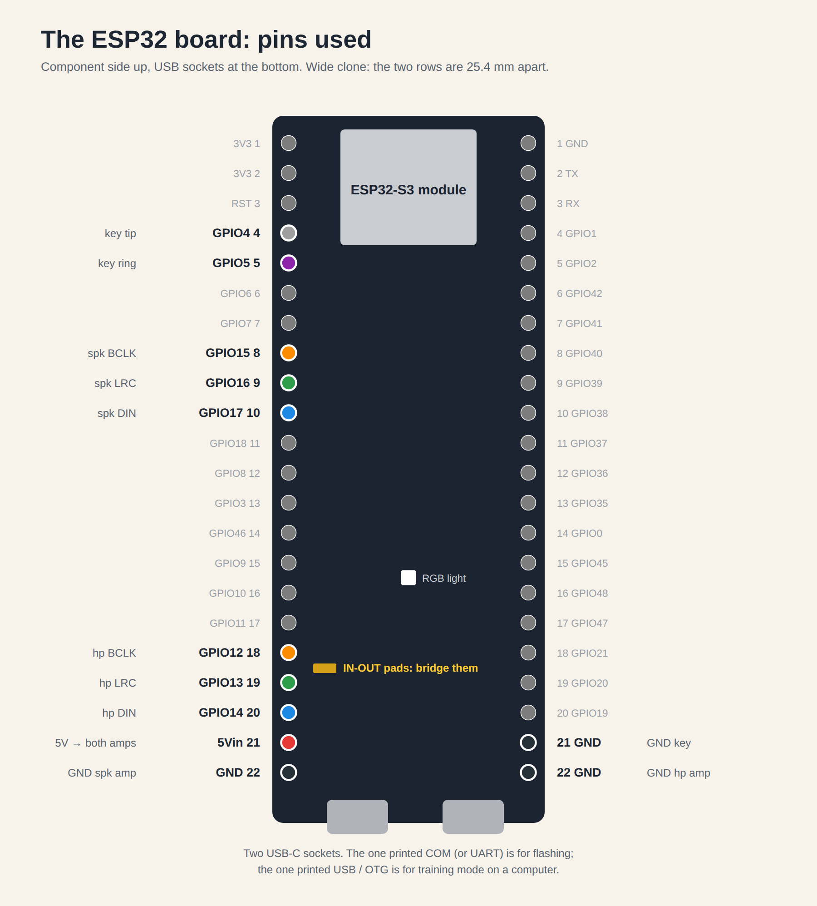

**Bridge the IN-OUT pads.** On this board the 5Vin pin (J1 pin 21) only gives out the USB 5 V when the
two small pads marked IN-OUT are joined. Melt a small blob of solder across them.

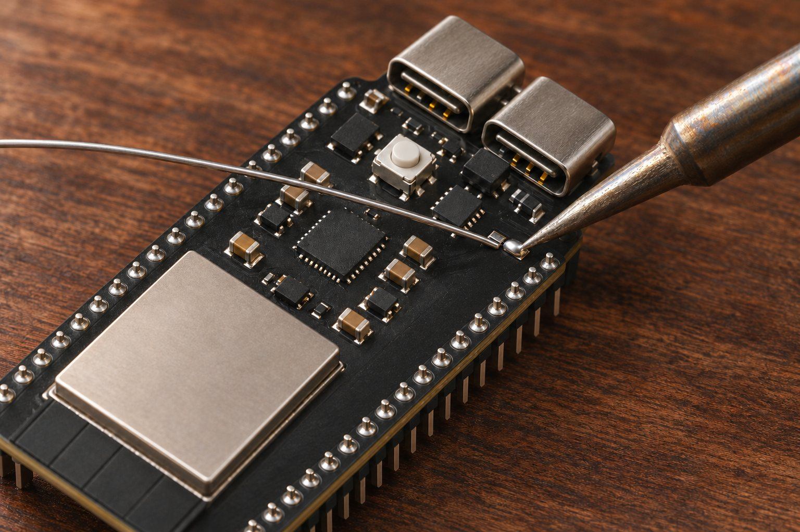

**Check it:** plug USB in and measure between 5Vin (J1-21) and GND (J1-22). You should see about 5 V. With
the pads open you see about 0 V.

**Install the firmware now**, before anything is soldered, so you know the board works:

1. Download `fjarrnyckel-usb.bin` from the
   [latest release](https://github.com/sa3lej/fjarrnyckel/releases/latest).
2. Connect the board with a USB **data** cable to the USB-C socket marked **COM** (or UART). If no serial
   port appears on the computer, try another cable, or install the CH343 USB driver.
3. Open the [Espressif web flasher](https://espressif.github.io/esptool-js/) in Chrome or Edge and press
   **Connect**; choose the board's serial port.
4. Under *Flash address* type **0x0**, choose `fjarrnyckel-usb.bin`, and press **Program**.
   If it hangs on *Connecting*: hold the board's **BOOT** button, press and release **RST**, release
   BOOT, and press Connect again.
5. When it is done, unplug and plug in again. The light on the board shows that the box is starting, and a
   Wi-Fi network called **Fjarrnyckel-XXXX** appears.

You only do this once. Later updates come from the box's own page: **Box → Software → Look for
updates**. (For *Install from a file…* use `fjarrnyckel-update.bin`; `fjarrnyckel-usb.bin` is only for this
first install.)

## 5. Wire it

Everything uses the board's left row **J1** (counted from the top with the USB sockets at the bottom and
the components facing you), plus two GND pins at the bottom of the right row **J2**.

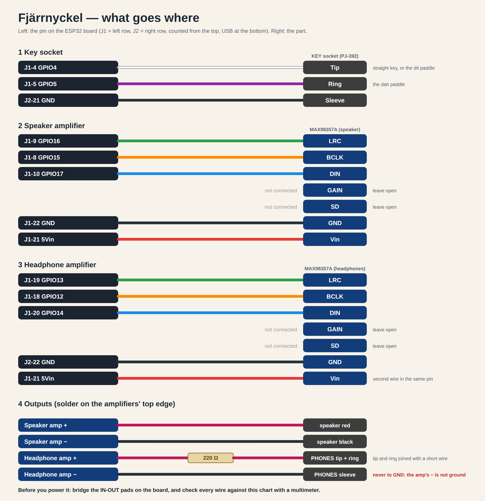

**The board.** The pins point down into the box, so solder the wires to the tops of the pins, on the
component side. Keep them short and leave them on the J1 side: in the box that row faces the speaker.

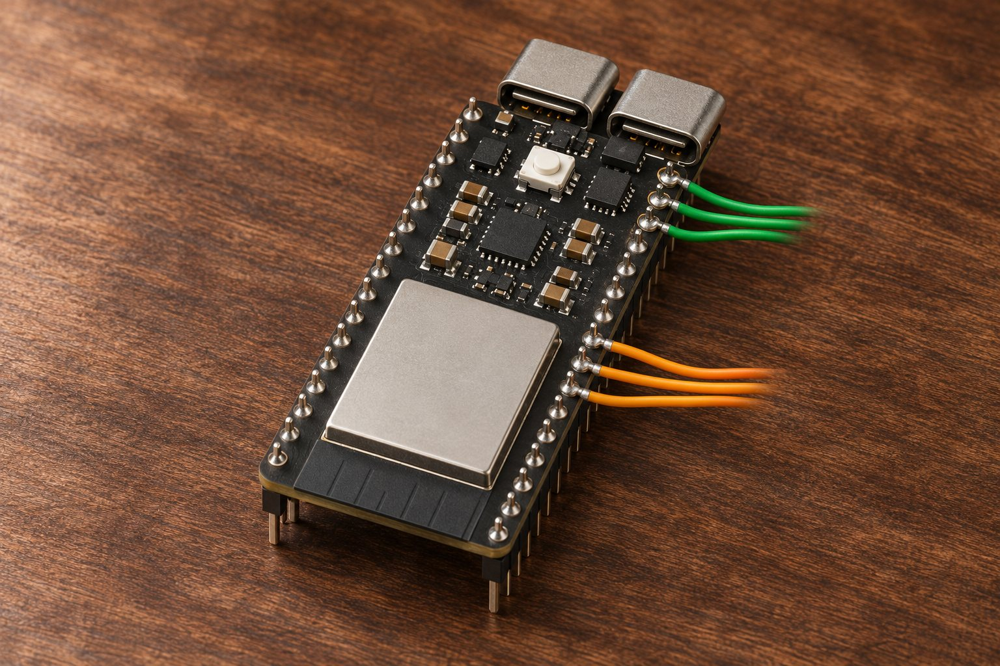

**Always unplug USB before you solder.**

**The amplifiers.** Before soldering, dry-fit: stand the amplifier in its two grooved posts. The 7-pin row
runs along the bottom edge, and the pins must stick out on the side that faces the speaker, because that
is where the plugs go. Then solder the straight 7-pin header to each amplifier. Leave **GAIN** and **SD**
unconnected. Push Dupont plugs onto the five pins you use (LRC, BCLK, DIN, GND, Vin), cut the other ends and solder them to the board as
in the chart. Then solder the outputs on the opposite edge:

- speaker amplifier: **+** to the speaker's red wire, **−** to its black wire;
- headphone amplifier: **+** through the 220 Ω resistor to the PHONES socket's **tip**, with tip and
  **ring** joined by a short wire so you hear it in both ears; **−** to the PHONES socket's **sleeve**.

Neither amplifier's − is ground. Never connect the PHONES sleeve to GND or to the KEY socket, and never
join the two amplifiers' − wires.

**The sockets.** Fit both sockets in the back wall with their nuts first (KEY on the right, PHONES on the
left, seen from behind). Find each lug with the multimeter and a plug: the **sleeve** lug connects to the
long part of the plug nearest the cable, the **tip** lug to the point, the **ring** lug to the band in
between. Then solder:

- KEY: tip to J1-4 (GPIO4), ring to J1-5 (GPIO5), sleeve to J2-21 (GND);
- PHONES: as above, from the headphone amplifier.

Cover every joint with heat-shrink.

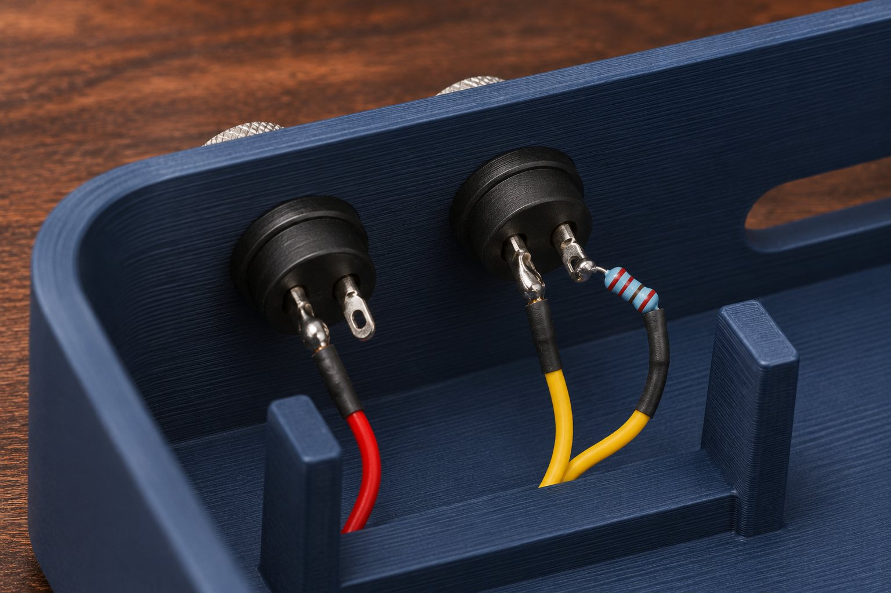

## 6. Put it together

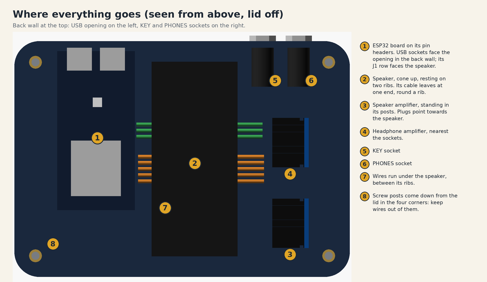

1. Slide each amplifier down into its two grooved posts with the plugs facing the speaker: the speaker
   amplifier at the front, the headphone amplifier at the back, next to the sockets.
2. Set the ESP32 board on its two saddles with the USB sockets in the opening in the back wall. The black
   plastic strips of the pins rest on the saddles.
3. Lay the wires flat on the floor between the board and the amplifiers.
4. Put the speaker on its two ribs, cone up, over the wires. Lead its cable round the end of a rib.
5. A dab of hot glue over each amplifier's row of plugs keeps them from working loose (a loose plug
   crackles).

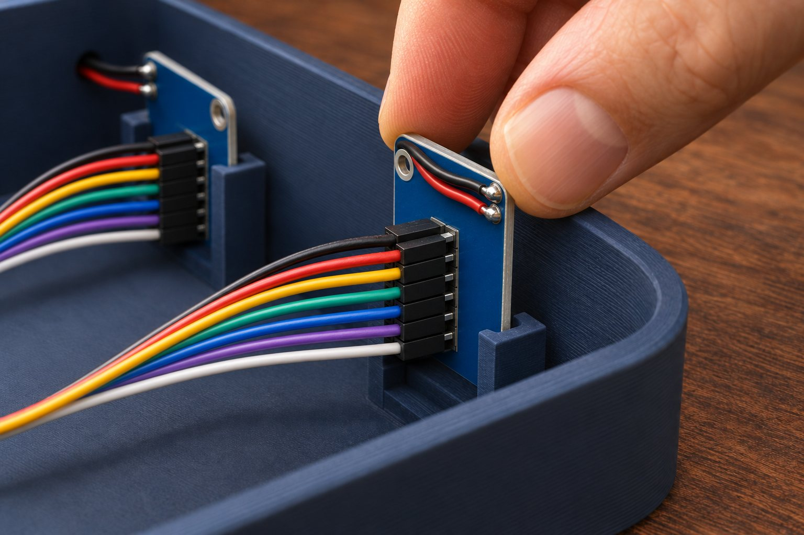
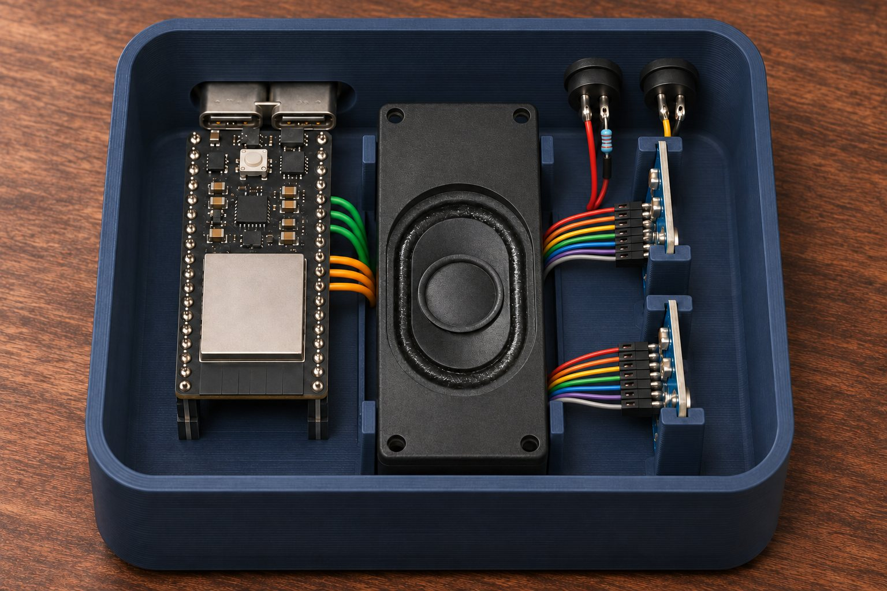

**Check before power.** With USB unplugged, use the multimeter's beep test:

- 5Vin (J1-21) to GND (J1-22): **no** beep (no short);
- each wire against its neighbours on the board: no beep;
- PHONES sleeve to GND and to the KEY sleeve: no beep;
- every wire in the chart from end to end: beep.

**Then power it.** Plug USB in with the key released. You hear two short tones (low, then high) and the
light comes on. Press a straight key: you hear the sidetone in the speaker, and in headphones too (each has
its own volume on the page). A new box starts as *Straight key*; for a paddle, set **Key → Key type →
Paddle**. The tip is dit and the ring is dah; *Paddle sides* swaps them. Unplug USB again before you
close the box.

## 7. Close it

1. Stick a small piece of 1 mm foam tape on each of the four pads around the speaker frame inside the
   lid, and the 0.5 mm foam pad on the end of the short post that rests on the board's metal can.
2. Drop the lens into the light window from above; a tiny drop of glue at its edge keeps it in.
3. Lower the lid straight down: the four small pins find the speaker's corner holes.
4. Turn the box over and fit the four M3 × 8 screws. Stop as soon as they are snug.
5. Stick the four feet into the round seats underneath.

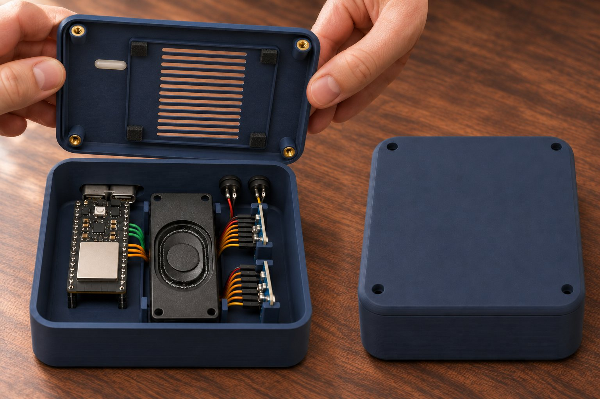

## 8. Start it

1. On your phone or computer, join the Wi-Fi network **Fjarrnyckel-XXXX**. The box's page opens by itself;
   if it does not, browse to **http://192.168.4.1**.
2. Under **Connection → Wi-Fi**, choose your home network, type its password and press **Connect**. Then
   put your phone or computer back on your home network and open **http://fjarrnyckel.local** (or the
   address the page showed). The setup network switches itself off a minute after the box has joined.
3. Set up the computer by the radio: [Installing the receiver on a Raspberry Pi](receiver-raspberry-pi.md).
   Then, under **Connection → Radio link**, enter the **Receiver address** and the **Shared key**, leave
   **Port** at 7373 and press **Save**. For the first test put the radio in CW with break-in off, and listen
   to the radio's own sidetone before you transmit.
4. To key the radio from anywhere: put the computer by the radio and the box on the same Tailscale
   network. On the box, **Connection → Tailscale → Connect to Tailscale**, then **Sign in to Tailscale**.
   Use the receiver's Tailscale name as the receiver address and leave **Relay** on *Automatic*.
5. Under **Box → Backup**, type a passphrase and press **Download backup**. Keep the file and the
   passphrase: you need both to restore it.

**Practice sites on a computer.** Connect the board's other USB socket (marked USB / OTG) to the
computer with a data cable and set **Key → The key goes to → The computer (training)**. Choose *Finished
keying* to use the box's own keyer and sidetone, or *The two paddles* to let the site do the keying.
Nothing goes to the radio in training mode.

**What the light means**

| Light | Meaning |
|---|---|
| blue, blinking | the setup network is up: join it and set up Wi-Fi |
| red | no Wi-Fi |
| amber | Wi-Fi is there, the radio is not ready yet |
| green | ready: the key goes to the radio (bright while keyed) |
| turquoise | training mode: the key goes to the computer on USB |
| violet, blinking | an update is being installed |
| white | service mode |

You hear "R" in Morse when the box has been ready to key the radio for a second, and two low tones when it
has not been for three seconds. The tones wait until the key is up, and can be switched off under
**Box → Signals**.

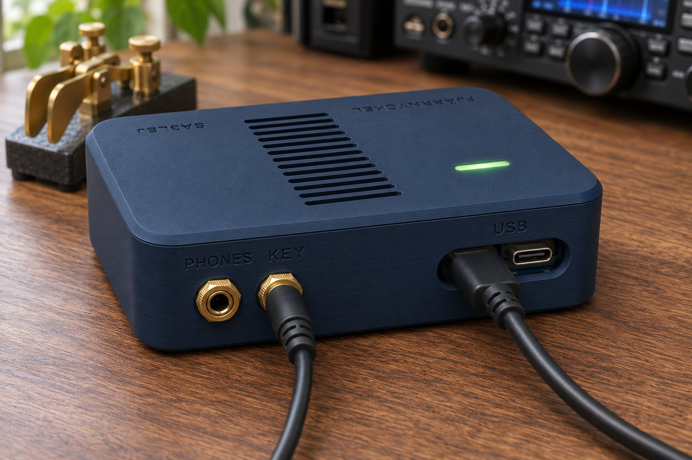

73 and have fun!
